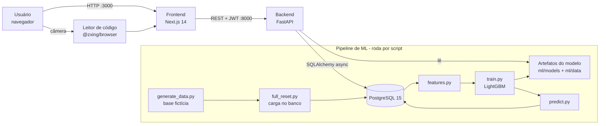
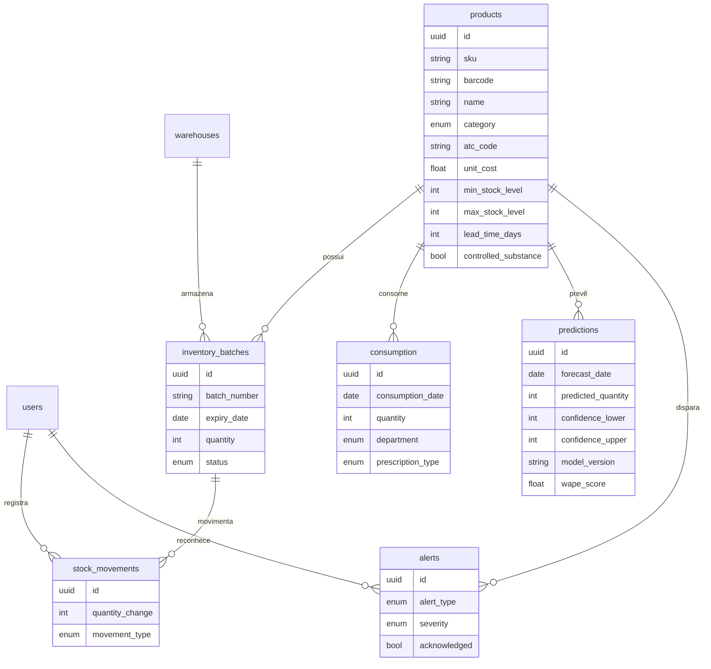

# Arquitetura

## Visão de componentes

| Parte | Tecnologia | Pasta |
|---|---|---|
| Frontend | Next.js 14 (App Router), React 18, Tailwind, React Query, Recharts | `frontend/` |
| Backend | FastAPI, SQLAlchemy 2 async, Alembic, Pydantic 2, JWT | `backend/app/` |
| Banco | PostgreSQL 15 | `docker-compose.yml` |
| ML | Polars, LightGBM, scikit-learn, Faker | `backend/ml/` |
| Infra | Docker Compose, GitHub Actions | `docker-compose.yml`, `.github/` |

## Fluxo de uma previsão

1. `ml/run_pipeline.py` lê o consumo do banco, gera as variáveis, treina o modelo e grava:
   - `ml/models/model_production.pkl`: modelo treinado
   - `ml/data/metrics_production.json`: métricas no teste
   - `ml/data/model_report_production.json`: dados dos gráficos da tela **Modelo**
   - tabela `predictions`: previsão de cada produto
2. O backend lê esses arquivos e a tabela e serve em `/api/v1/predictions/...`.
3. O frontend exibe nas telas **Previsões**, **Modelo** e no **Dashboard**.

O modelo roda **dentro do processo do backend** (sem servidor de modelo separado): o arquivo `.pkl`
tem ~2,5 MB e a inferência leva milissegundos.

## Modelo de dados

Também existe `audit_logs` (quem alterou o quê, com valores antigos e novos). Definição completa:
`backend/app/models/__init__.py`. Migrações: `backend/alembic/versions/`.

## Decisões de arquitetura

| # | Decisão | Por quê |
|---|---|---|
| 1 | **Monólito FastAPI** em vez de microsserviços | Um time pequeno, um domínio só; menos infraestrutura |
| 2 | **PostgreSQL** para tudo (inclusive séries de consumo) | ~1 milhão de linhas de consumo cabem bem com índices por produto/data |
| 3 | **Base fictícia** como parte do pipeline | Dados reais de hospital são sigilosos (LGPD); a simulação é reproduzível (seed 42) |
| 4 | **Inferência no próprio backend** | Modelo pequeno; evita um serviço a mais |
| 5 | **Previsão em lote por script** em vez de fila (Celery) | Previsão diária não precisa de tempo real |
| 6 | **JWT** com access + refresh token | API sem estado, padrão do FastAPI |
| 7 | **Blend modelo + média móvel** | Reduz erro em produtos de baixo giro; peso escolhido na validação |

O planejamento inicial (com Celery, Redis, MLflow etc.) está em
[planejamento/](planejamento/LEIA-ME.md), com a comparação do que mudou.
