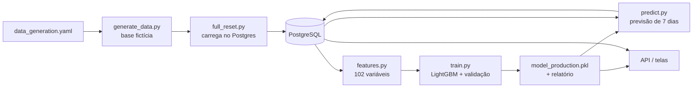
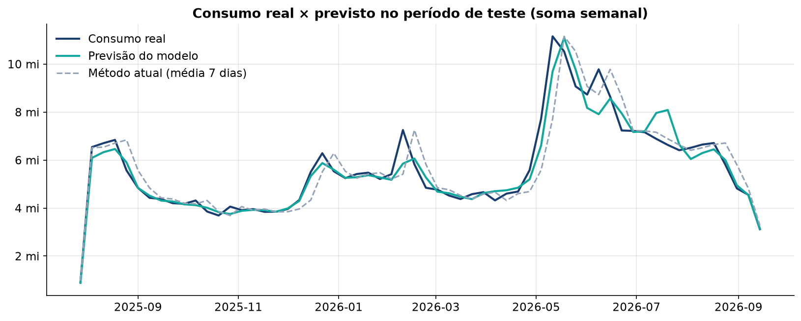
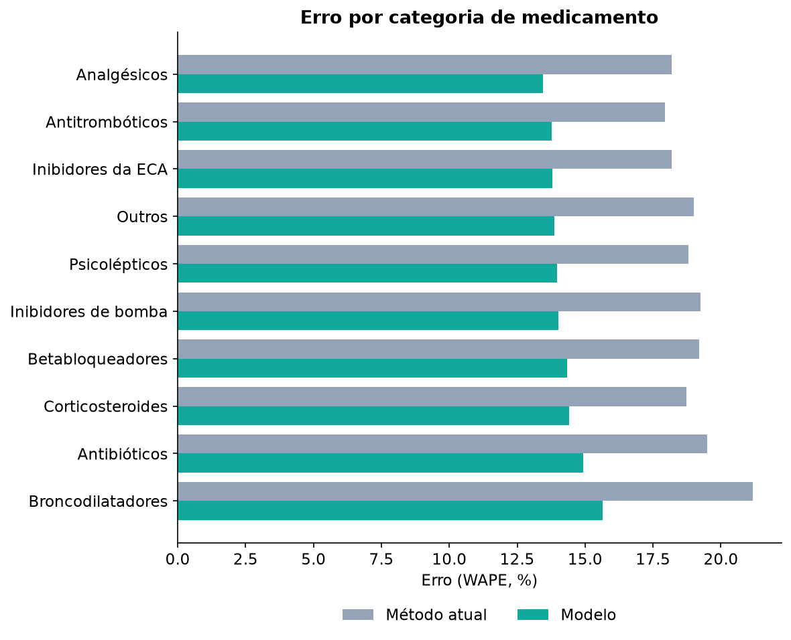

# Pipeline de ML

Prevê o **consumo total dos próximos 7 dias** de cada medicamento. O código fica em `backend/ml/`
e roda por script, a partir de `backend/`, com o Postgres no ar.

## Etapas

| # | Script | O que faz | Peso |
|---|---|---|---|
| 1 | `ml/generate_data.py` | Gera a base fictícia em `ml/data/synthetic/` (config: `ml/config/data_generation.yaml`) | médio |
| 2 | `ml/full_reset.py` | **Apaga o banco**, recria as tabelas (Alembic) e carrega a base fictícia; dá códigos de barras aos produtos | médio |
| 3 | `ml/run_pipeline.py` | Roda `features.py` → `train.py` → `predict.py` | **pesado** (treino) |
| 4 | `ml/report.py` | Gera os gráficos do modelo em `docs/imagens/` | leve |

Atalhos que **não treinam** (servem depois de um `full_reset.py`, com o modelo já salvo):

| Script | O que faz |
|---|---|
| `ml/predict.py` | Refaz as previsões de 7 dias de todos os produtos (arquivo + tabela `predictions`) |
| `ml/build_report.py` | Refaz o relatório da tela **Modelo** a partir do modelo e do teste salvos |
| `ml/barcodes.py` | Atribui códigos EAN-13 fictícios (prefixo 789) aos produtos sem código |

## Base fictícia

- **500 medicamentos** em 10 categorias, 12 almoxarifados, consumo diário por setor (UTI,
  Emergência, Enfermaria, Ambulatório) de **jan/2021 a out/2026**.
- O consumo segue padrões realistas: sazonalidade anual por classe (ex.: broncodilatadores no
  inverno), feriados nacionais, fim de semana, ruído e picos ocasionais.
- Estoque, lotes, validades, pedidos de compra e alertas são simulados junto com o consumo.

**Limitação conhecida:** o estoque máximo de cada produto é 2,5 dias de consumo
(`max_stock_multiplier: 2.5`). Por isso o sistema mostra todos os produtos com risco de falta.
Para corrigir, aumente `min_stock_multiplier`/`max_stock_multiplier` e refaça as etapas 1 a 3.

## Variáveis do modelo (102)

Montadas por `ml/features.py`, por produto e dia:

| Grupo | Exemplos |
|---|---|
| Consumo passado | consumo de 1, 2, 7, 14, 30 dias atrás; diferenças e razões entre eles |
| Médias móveis | média, desvio, mínimo e máximo de 7, 14 e 30 dias |
| Histórico total | média e desvio desde o início |
| Calendário | dia da semana, dia do mês, mês (também em seno/cosseno) |
| Eventos | feriados e janelas sazonais |
| Anomalias | pico em relação à média, volatilidade |
| Produto e estoque | categoria, custo, prazo de reposição, estoque disponível |

## Treino

- **Algoritmo:** LightGBM, treinado em escala `log1p` (reduz o peso dos produtos de alto giro).
- **Divisão temporal, sem vazamento de futuro:** o teste é o último ~20% do período; a validação,
  os 180 dias anteriores ao teste. O modelo nunca vê datas posteriores às que prevê.
- **Parada antecipada** na validação (melhor iteração: 108).
- **Combinação com o método atual:** a previsão final é `0,75 × modelo + 0,25 × média de 7 dias`.
  O peso 0,75 foi escolhido na validação, não no teste.

## Resultados

Modelo treinado em 22/10/2026. Teste de **03/08/2025 a 18/09/2026** (205.998 previsões).
O **método atual** é o que a farmácia usa hoje: média de consumo dos últimos 7 dias × 7.

| Métrica | Modelo | Método atual |
|---|---|---|
| **WAPE** (erro total relativo) | **14,3%** | 19,1% |
| MAPE (erro médio por previsão) | 14,0% | 19,2% |

**O modelo erra 4,8 pontos percentuais a menos, 25% menos erro que o método atual.**

| Faixa de giro | WAPE do modelo |
|---|---|
| Baixo giro | 13,9% |
| Médio giro | 13,5% |
| Alto giro | 14,6% |

### Erro por categoria

O modelo ganha do método atual em **todas** as categorias.

| Categoria | Modelo | Método atual |
|---|---|---|
| Analgésicos | 13,5% | 18,2% |
| Antitrombóticos | 13,8% | 17,9% |
| Inibidores da ECA | 13,8% | 18,2% |
| Outros | 13,9% | 19,0% |
| Psicolépticos | 14,0% | 18,8% |
| Inibidores de bomba (IBP) | 14,0% | 19,2% |
| Betabloqueadores | 14,3% | 19,2% |
| Corticoides | 14,4% | 18,7% |
| Antibióticos | 14,9% | 19,5% |
| Broncodilatadores | 15,7% | 21,2% |

### Variáveis mais importantes

| Variável | Importância |
|---|---|
| Média móvel de 7 dias | 58,5% |
| Média móvel de 14 dias | 26,8% |
| Média móvel de 30 dias | 6,0% |
| Média histórica | 1,6% |
| Máximo de 7 dias | 0,8% |

O modelo aprendeu o que faz sentido: o consumo recente pesa mais, e o calendário ajusta os picos.

### Gráficos

Gerados por `ml/report.py` em `docs/imagens/` (os mesmos dados da tela **Modelo**):

| Arquivo | Mostra |
|---|---|
| `modelo-real-vs-previsto.png` | Curvas do consumo real, do modelo e do método atual no período de teste |
| `modelo-vs-metodo-atual.png` | Erro do modelo × método atual |
| `modelo-erro-por-categoria.png` | Erro por categoria |
| `modelo-importancia-variaveis.png` | Variáveis mais importantes |

No gráfico real × previsto, cada ponto soma os alvos de 7 dias de todos os produtos naquela
semana; serve para comparar as curvas entre si, não como consumo semanal absoluto.

## Como a previsão chega ao sistema

1. `predict.py` calcula, para cada produto, a previsão dos próximos 7 dias a partir do último dia
   com dados e grava em `ml/data/predictions.parquet` e na tabela `predictions`.
2. A API usa essa previsão no Dashboard (risco de falta), na tela **Previsões** e no detalhe do
   produto, onde ela é distribuída por dia, com faixa esperada de ±20%.
3. O relatório da tela **Modelo** vem de `ml/data/model_report_production.json`.

Depois de recriar o banco (`full_reset.py`), os produtos ganham IDs novos: rode `predict.py` de
novo, senão as previsões não aparecem.
